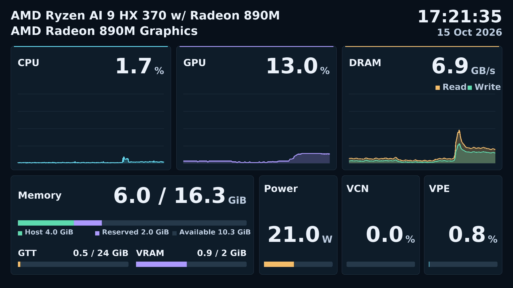

# Hardware-encoded resource dashboard

`amdva-dashboard` samples the local AMD APU, draws the approved
[dashboard composition](../../../examples/resource-dashboard/index.html) on GPU surfaces,
and serves H.264 over RTSP. It needs no browser, desktop session, Qt, model or
inference engine. The HTML remains a synthetic visual prototype; the native
server uses real readings and does not show its DEMO badge.

## Build and start

The normal locked bootstrap builds the dashboard by default. Additional font
and DRM packages are installed under `.deps`, with no system package changes.

```bash
python3 scripts/bootstrap.py
source scripts/env.sh
build/examples/resource-dashboard/amdva-dashboard --power-max-w 48
```

The server listens on all IPv4 interfaces at port 8554, mount `/dashboard`.
Connect from another PC using `rtsp://<server-IP>:8554/dashboard`. This sample
provides unauthenticated RTSP; it adds no authentication or TLS layer. For use
on this PC only, pass `--bind 127.0.0.1`.

For a dashboard-only build after preparing dependencies:

```bash
source scripts/env.sh
cmake -S . -B build-dashboard \
  -DAMDVA_BUILD_NVR=OFF -DAMDVA_BUILD_PLUGINS=OFF \
  -DAMDVA_BUILD_STREAMING=OFF -DAMDVA_ROCM_ROOT="$AMDVA_ROCM_ROOT"
cmake --build build-dashboard -j6
build-dashboard/examples/resource-dashboard/amdva-dashboard --power-max-w 48
```

`AMDVA_BUILD_DASHBOARD=OFF` omits the sample. The reusable `amdva_monitor`
library is built and installed independently. The existing runtime still
requires the repository's HIP/libva dependencies; the dashboard performs no
HIP inference and links neither Qt nor MIGraphX.

| Option | Default | Meaning |
| --- | --- | --- |
| `--bind` | `0.0.0.0` | Listener address |
| `--port` | `8554` | RTSP port, 1–65535 |
| `--mount` | `/dashboard` | Absolute RTSP mount path |
| `--render-node` | `/dev/dri/renderD128` | AMD DRM render device used for measurement, GL and VA |
| `--fps` | `10` | Integer output frame rate, 1–60 |
| `--bitrate-kbps` | `4000` | Encoder target bitrate in kbps |
| `--power-max-w` | `48` | Positive finite Power bar scale in watts |
| `--font` | automatic | Font file; local locked DejaVu Sans Bold is preferred when `AMDVA_ROOT` is set, then Fontconfig |
| `--duration-seconds` | unlimited | Optional timed shutdown, useful for tests |
| `--cpu-name`, `--gpu-name` | detected | Text shown instead of the CPU name from `/proc/cpuinfo` and the GPU marketing name from libdrm; printable ASCII, up to 120 characters |

Resolution is 1920 × 1080, progressive, NV12, BT.709 limited range. H.264 has
no B frames and a one-second maximum keyframe interval. Audio is absent.
Invalid command-line values are rejected. `--help` requires no GPU initialization.
The Power scale changes only the visualization; it does not alter a machine
power limit. Real readings above the scale remain visible, with the bar saturated.

## Receiving and NVR integration

Add a camera in the NVR's **Cameras** page with URL
`rtsp://127.0.0.1:8554/dashboard` when both run on this PC. Select it in **Live**.
It records like other registered sources and is available in **Recordings**
for hardware playback. Selected channels also follow the NVR's configured AI
policy, even though the dashboard itself has no AI dependency.

To inspect the stream independently, for example with FFmpeg installed:

```bash
ffplay -rtsp_transport tcp rtsp://127.0.0.1:8554/dashboard
ffmpeg -rtsp_transport tcp -i rtsp://127.0.0.1:8554/dashboard \
  -t 30 -c copy dashboard.mkv
```

Multiple RTSP clients share the same encoder and resource history. When the
last client disconnects, frame generation stops; measurement continues and a
new client can start a fresh media session. Appsrc, raw-frame queue and VA pool
are bounded. Saturation skips rendering work rather than retaining an unlimited
frame backlog. PTS/DTS are based on each media session's monotonic clock;
missed frame intervals are not emitted in a catch-up burst.

## GPU surface path

```text
/proc + amdgpu sysfs -> ResourceMonitor -> bounded history / drawing geometry
                                                    |
                         EGL/GLES FBO -> shared BGRA VA surface
                                                    |
                              VA VideoProc -> NV12 VAMemory pool
                                                    |
                         appsrc -> vah264enc -> h264parse -> RTP -> RTSP
```

The EGL device is selected by the same DRM render node as VA. A writable
DMA-BUF export is imported as a framebuffer attachment. GL fences complete the
draw before VA conversion; VA synchronization completes NV12 writes before
encoder submission. Buffer ownership prevents pool reuse while the encoder
retains a frame. The encoder sink verifies the submitted VA surface identities
and shared display. A bounded SPS rewrite on the compressed encoder output
explicitly signals BT.709 primaries, transfer, matrix and limited range, because
the locked VA encoder does not emit those VUI fields from input caps alone.
Slice data and timing are preserved; this is compressed-header processing,
not a raw-image transfer.

No frame image is mapped, downloaded or uploaded on the CPU. Font glyphs are
rasterized and uploaded once at startup; ongoing CPU uploads are geometry, not
video pixels. Encoded bitstream buffers are handled on the CPU for RTP/network
transmission. This is a GPU-resident raw-image path, not a claim that compressed
network data never touches the CPU. Software rendering and software encoding
fallbacks are not provided; required EGL/VA failures stop the server.

On the validated Radeon 890M / Mesa 25.2.8, VPE rejects NV12 as an output
format. VA VideoProc performs this RGB-to-NV12 operation through the GPU
compositor instead. This still avoids CPU pixel transfers. It differs from the
NVR's supported NV12-to-BGRA VPE scaling direction. VPE utilization can therefore
remain unavailable when no other observable VPE client exists.

Mesa 25.2.8 also defers equal-region format conversion to its encoder after the
first 16 frames, causing VA processing failure and potentially retaining a
mutable RGB source. The renderer uses a 1920 × 1082 BGRA allocation, draws into
rows 2–1081, and explicitly converts that rectangle into 1920 × 1080 NV12 at
origin zero. Differing source/destination origins avoid that EFC shortcut,
without cropping dashboard content or adding a CPU copy. Relevant Mesa sources:
[postprocessing](https://github.com/chaotic-cx/mesa-mirror/blob/mesa-25.2.8/src/gallium/frontends/va/postproc.c),
[picture submission](https://github.com/chaotic-cx/mesa-mirror/blob/mesa-25.2.8/src/gallium/frontends/va/picture.c).



## Measurement contract

The Qt-free public header `amdva/resource_monitor.hpp` exposes `ResourceMonitor`,
`ResourceMonitorConfig` and `ResourceSample`. `sample()` is a synchronous,
single-caller API with monotonic nanoseconds and wall-clock milliseconds.
Every metric is optional: absent means unsupported, inaccessible, invalid or
not yet measurable. Read-time procfs failures during process exit are treated
as missing data rather than terminating the monitor. This is separate from
video latency telemetry.

Sampling normally runs every 100 ms; history retains at most 601 samples and
60 seconds. Hardware SMU averages may have approximately one-second filtering.
No fictitious history is generated at startup. Missing data or long sample gaps
interrupt graph lines and their fill. Device names are detected at startup;
calendar time uses the host's local timezone.

| Reading | Source and interpretation |
| --- | --- |
| CPU | `/proc/stat` deltas, 0–100% for the whole system; first sample is absent |
| GPU | `gpu_busy_percent` for the selected AMD device |
| VCN | Preferred: busiest encode/decode engine class (`enc`, `dec`, `enc_1`) from readable DRM client busy-time deltas; `vcn_busy_percent` fallback when no paired DRM counters are available |
| Host memory | `/proc/meminfo` total and total minus available |
| VRAM reservation / used | `mem_info_vram_total` / `mem_info_vram_used` |
| GTT used / limit | `mem_info_gtt_used` / `mem_info_gtt_total` |
| DRAM read / write | Validated little-endian `gpu_metrics` v3.0 read/write bandwidth, converted from MB/s to decimal GB/s |
| Socket power | Same v3.0 blob, mW converted to W |
| VPE | Busy-time deltas over readable `/proc/PID/fdinfo` clients on the selected PCI device, deduplicated by device/client ID and normalized for engine capacity |

The v3.0 parser verifies revision, declared size and available bytes, and treats
unavailable sentinels as absent. Other revisions do not produce invented values;
independent sysfs readings continue. No root access or system tuning is needed.
DRM-based VCN and VPE cover readable clients, not a guarantee of global coverage.
Each class is normalized by its reported engine capacity (default one); aliases
are deduplicated by PCI device, client ID and engine class, while independent
clients on the selected device are added. The single VCN value is the maximum
of these class percentages, not their sum: separate encode/decode engines can
run concurrently. JPEG is not included. This is a busy-time estimate, not a
percentage of peak codec throughput. On VCN4 the unified encode/decode queue
is accounted under `enc`, including NVR decoding.

On the validated Radeon 890M, `vcn_busy_percent` remains zero during active
hardware encoding and decoding, while DRM counters advance. Therefore paired
DRM readings take precedence, including measured zero. First observations,
missing counters and regressions have no DRM delta; VCN then falls back to
valid sysfs data, and VPE remains unavailable. Regressions retain the high
watermark until the counter catches up; exited clients are discarded. See the
[kernel DRM statistics contract](https://docs.kernel.org/gpu/drm-usage-stats.html),
[amdgpu engine names](https://github.com/torvalds/linux/blob/v6.17/drivers/gpu/drm/amd/amdgpu/amdgpu_fdinfo.c)
and [VCN4 unified queue implementation](https://github.com/torvalds/linux/blob/v6.17/drivers/gpu/drm/amd/amdgpu/vcn_v4_0_5.c).

Memory is binary GiB. The main total is Host capacity plus dedicated VRAM
reservation, and its numerator is Host used plus that complete reservation.
GTT is neither added again nor subtracted from Host. Separate lower bars show
GTT against its own limit and VRAM used against its reservation. This describes
managed regions rather than all physically installed RAM. For example, the
validation PC has `mem=16G`; the displayed detected capacity is approximately
16.3 GiB including its 2 GiB reservation, not the HTML fixture's 32 GiB. The boot
setting is not modified. See [the prototype definitions](PROTOTYPE.md)
for the shared accounting rationale and original reference repository.

## Validation

VCN counter regression (2026-10-15): while the existing dashboard encoder and
NVR decoder were active, sysfs reported 0% but the corrected monitor measured
8.7–9.1% over five one-second intervals. An isolated 20-second headless server
on port 8596 with a 12-second RTSP recording reported 13.6–13.8% during its
additional encode workload, 124 submitted frames, zero skipped frames and zero
copy-audit errors. The recording contained 121 H.264 1920×1080 BT.709 limited
frames. All eight dashboard-only CTest contracts passed, including new VCN
counter, capacity, alias, multi-client, PCI filter, idle, fallback, regression
and malformed-input cases. Local artifacts: `artifacts/dashboard-vcn-live.log`
and `artifacts/dashboard-vcn-rtsp/`. These observations demonstrate busy-time
reporting under this workload; they do not calibrate peak codec throughput.

Run the real RTSP scenarios after building, using an unused output directory:

```bash
source scripts/env.sh
python3 examples/resource-dashboard/validate.py --seconds 600 --output artifacts/dashboard-check
```

The tool starts the server without DISPLAY/Wayland, enables copy/GL-image
auditing, receives simultaneous clients, exercises all-client disconnect and
reconnect, kills a second client abruptly, and verifies recorded H.264 files.
It captures a decoded diagnostic image in the receiving process only. After a
240-second warmup, existing 64 MiB RSS/GPU and 44-FD growth guards apply. FPS
and resource usage are observations, not an operational performance rating.

`resource-monitor-contract` covers metric ABI/units/sentinels, missing data,
CPU deltas, memory capacities, duplicate DRM FDs, first samples and client/counter
lifecycle. CLI tests exercise help and invalid settings. The SPS contract checks color
signaling, preserved geometry/timing, unchanged non-SPS NALs and malformed data. The copy-audit contract
also checks opt-in GL readback detection. Existing NVR diagnostic captures keep
GL auditing disabled; the dashboard enables it after the startup font upload.

When NVR is built, `amdva-dashboard-nvr-validate CONFIG.json` is a manual test
helper for a single selected dashboard source. It verifies live decoding,
rendering and AI, catalog recording and hardware playback. Use a separate config
and recording root with five-second segments. The installed production server
does not depend on this helper or Qt.

### Recorded results

The [validation record](validation-results.json) identifies
the implementation revision, frozen-runtime differences, hashes and local
artifacts. All 23 CTest cases passed. A 600-second headless run passed shared
clients, all-client disconnect/idle/reconnect and abrupt-client disconnect;
all three recordings were valid 1080p H.264 at 10fps. After warmup, maximum
growth was 68 KiB RSS, zero GPU allocation and three FDs, within existing guards.
There were no copy-audit violations.

The final implementation passed a separate 110-second RTSP regression and
30fps/65W LAN-listener test. The latter recorded 1,501 frames over 50 seconds
with BT.709 primaries/transfer/matrix and limited range. NVR live rendering, AI,
recording search and hardware playback passed; all NVR fragments finalized and
passed media inspection. Active-client timed server shutdown completed without
GStreamer criticals. A dashboard-only build linked neither Qt nor MIGraphX, and
an installed CMake SDK client used `AMDVA::amdva_monitor` successfully.

The DRAM history is stacked: amber Read starts at zero and green Write sits above
it. The top edge shows Read + Write, matching the numeric GB/s value. Its vertical
scale follows the combined peak over the displayed history (20 GB/s increments,
minimum 20 GB/s). Missing read or write samples leave a gap in both areas.
