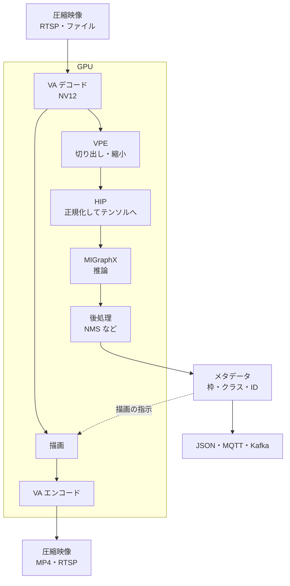
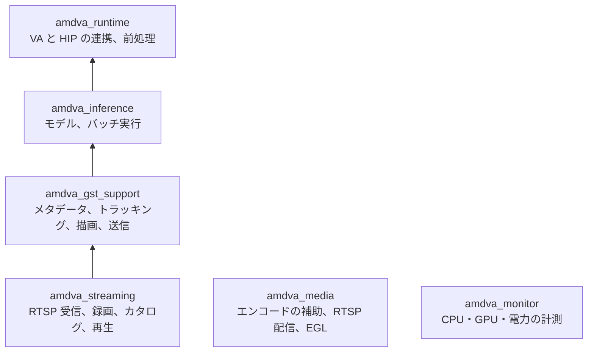

# 仕組み

このフレームワークは、デコードした映像を最後まで GPU のメモリに置いたまま処理します。フレームワークの要素では、CPU が扱うのは圧縮された映像データと、検出結果などの小さなメタデータだけで、画素のコピーや変換は CPU では行いません。アプリケーションが独自の処理のためにコピーを加えることはあり、例えば [NVR デモ](nvr-demo.ja.md) の人物検索は、切り出した人物の画像を CPU に読み戻します。このページでは、対象のハードウェア、データの流れ、要素の役割、モデル、メタデータ、ライブラリの構成を説明します。

## Ryzen AI APU のハードウェア

このフレームワークは AMD Ryzen AI APU を対象にしています。APU は、性質の異なる複数の演算部を 1 つのチップにまとめたプロセッサーです。検証に使っている Ryzen AI 9 HX 370 には、次の 5 種類の演算部があります。

| 演算部 | 検証機での構成 | 得意な処理 | このフレームワークでの用途 |
| --- | --- | --- | --- |
| CPU | Zen 5 と Zen 5c、12 コア 24 スレッド | 汎用の処理 | ネットワークからの受信、録画ファイルの書き込み、メタデータの処理、アプリケーションの制御 |
| GPU | Radeon 890M（gfx1150） | 大量の並列計算と描画 | HIP による前処理と後処理、MIGraphX による推論、OpenGL ES による画面表示 |
| NPU | XDNA 2 | ニューラルネットワークの推論を少ない電力で行う | NVR デモの人物検索の埋め込み（Embedding）の計算。ONNX Runtime の Vitis AI 実行プロバイダーを通して使います |
| VCN | VCN 4.0.5 | 動画の符号化と復号（エンコードとデコード） | H.264/H.265/AV1 のデコードとエンコード。VA-API を通して使います |
| VPE | VPE 6.1.0 | 映像の縮小と拡大、色空間の変換、切り出し | 推論の入力サイズへの変換、表示用の縮小と色の変換。VA-API の映像処理を通して使います |

VCN（Video Core Next）と VPE（Video Processing Engine）は、映像のための専用回路です。VPE は、デコーダーが出力する NV12 形式の映像を推論や表示に使う BGRA 形式に変換し、同時に必要な大きさに縮小します。同じ処理は GPU のシェーダーでもできますが、VPE に任せると、GPU を推論や描画のために空けておけます。フレームワークは起動時に VPE が実際に動いたことを確かめ（[インストール](install.ja.md) の動作確認を参照）、VPE で処理できない場合に GPU のシェーダーや CPU で代わりに処理することはしません。

### メモリの共有とゼロコピー

APU では、すべての演算部が同じメインメモリ（DRAM）を共有します。デコードした映像のバッファーは、DMA-BUF という仕組みを使って、VCN、VPE、GPU（HIP、OpenGL ES）の間で同じメモリのまま受け渡せます。このように、データを複製せずに受け渡すことを「ゼロコピー」と呼びます。

一方、演算部の間でデータを複製（コピー）すると、同じ DRAM の中での複製であっても、メモリの帯域と時間を使います。2560×1440 の映像は 1 フレームで約 5.5 MB（NV12）あり、30 fps のカメラ 16 台分をコピーすると毎秒 2.6 GB になります。多数のカメラを扱うときは、このコピーを避けることが性能を保つ鍵になります。

## データの流れ

| 段階 | 実行するハードウェア | 内容 |
| --- | --- | --- |
| デコード、エンコード | VCN（VA-API） | H.264/H.265 のデコードと、H.264/H.265/AV1 のエンコード |
| 切り出し、縮小 | VPE（VA の映像処理） | 推論の入力サイズへの変換と、分類用の領域（ROI）の切り出し |
| 正規化 | GPU（HIP） | 画素をモデル入力のテンソル（float32）に変換 |
| 推論、後処理 | GPU（MIGraphX、HIP） | 推論、検出枠の絞り込み（NMS）、マスクやキーポイントの復元 |
| 描画 | GPU（VPE、HIP） | 検出枠、ラベル、ID、マスク、骨格の描画 |

セグメンテーションのマスクや推論の生の出力は、GPU 上のテンソルのまま保持されます。CPU に読み戻すのは、枠の座標やクラスなど上限のある結果だけです。

## 要素の役割

パイプラインは GStreamer の要素をつないで作ります。このフレームワークが提供する要素は次のとおりです。

| 要素 | 役割 |
| --- | --- |
| `amddetect` | 物体検出、インスタンスセグメンテーション、姿勢推定（YOLOv8 系） |
| `amdclassify` | 検出した物体ごと、またはフレーム全体の分類 |
| `amdinference` | セマンティックセグメンテーションなど、任意のモデルの推論 |
| `amdwatermark` | 検出結果の描画 |
| `amdencode` | ハードウェアエンコード |
| `amdpython` | 検出結果を受け取る Python 関数の呼び出し（画素は渡しません） |
| `amdmetapublish` | 検出結果を JSON Lines のファイル、MQTT、Kafka へ送信 |
| `gvatrack` ほか `gva*` | Intel DL Streamer から同梱したトラッキング、複数ストリームの束ね、メタデータ変換 |

推論の要素は、入力として GPU 上の NV12（`video/x-raw(memory:VAMemory),format=NV12`）だけを受け付けます。CPU 上のフレームを黙ってコピーすることはなく、つなぎ方が誤っていれば起動時にエラーになります。

## モデル

ONNX のモデルを `amdva-compile-model` でこの GPU 向けにコンパイルし、`.mxr` ファイルとして使います。前処理と出力の形式は、モデルと並べて置く `model-info.json` に書きます。

- バッチサイズは 1、2、4、8、16 のいずれかで、コンパイル時に固定します。
- コンパイルするとハッシュと GPU を記録したマニフェストも作られ、別の GPU 向けのモデルは読み込み時に拒否されます。
- 対応する出力形式は、YOLOv8 系の検出・セグメンテーション・姿勢推定、分類、セマンティックセグメンテーション、生のテンソルです。

`model-info.json` の項目は [model-info リファレンス](../dev/model-info.ja.md) を参照してください。

## メタデータ

検出結果は GStreamer 標準の GstAnalytics メタデータとしてフレームに付きます。下流の要素や自作のプローブは、DL Streamer と同じ方法で読み取れます。GPU 上のマスクやテンソル、フレームの識別情報は、このフレームワーク独自のメタデータに入ります。

`amdmetapublish` と `amdpython` は、同じ形式の JSON（スキーマ 1）を扱います。1 フレームが 1 レコードで、物体ごとにクラス、信頼度、枠、トラッキング ID、分類、キーポイントを持ちます。形式の詳細は [メタデータと Python](../dev/metadata-and-python.ja.md) を参照してください。

## ライブラリの構成

アプリケーションから使う場合は、CMake パッケージ `AMDVideoAnalytics` のライブラリをリンクします。矢印は、どのライブラリを使っているかを表します。

`amdva_media` と `amdva_monitor` は、ほかのライブラリに依存せずに使えます。使い方は [SDK でアプリケーションに組み込む](sdk.ja.md) で説明します。
