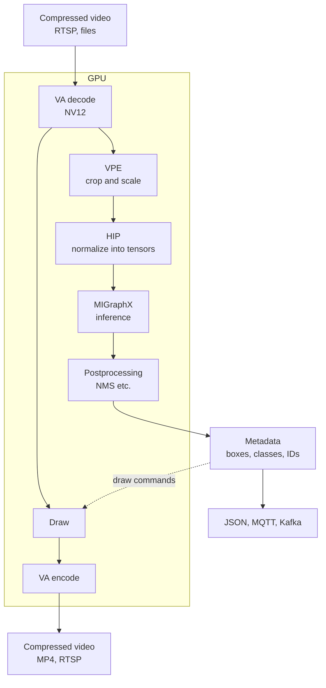
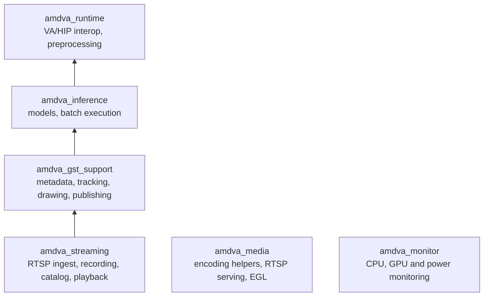

<!-- source: docs/guide/concepts.ja.md 521d88f0879a9745ea55d63815f8fd12604b1d0e -->
# Concepts

This framework keeps decoded video in GPU memory all the way through processing. The CPU handles only compressed video data and small metadata such as detection results; it never copies or converts pixels. This page describes the data flow, the roles of the elements, models, metadata and the library structure.

## Data flow

| Stage | Hardware | What it does |
| --- | --- | --- |
| Decode, encode | VCN (VA-API) | H.264/H.265 decoding and H.264/H.265/AV1 encoding |
| Crop, scale | VPE (VA video processing) | Conversion to the inference input size and cropping of regions (ROIs) for classification |
| Normalize | GPU (HIP) | Converts pixels into the model input tensor (float32) |
| Inference, postprocessing | GPU (MIGraphX, HIP) | Inference, bounding box filtering (NMS), mask and keypoint reconstruction |
| Draw | GPU (VPE, HIP) | Draws bounding boxes, labels, IDs, masks and skeletons |

Segmentation masks and raw inference outputs stay on the GPU as tensors. Only bounded results such as box coordinates and classes are read back to the CPU.

## Element roles

You build a pipeline by linking GStreamer elements. This framework provides the following elements.

| Element | Role |
| --- | --- |
| `amddetect` | Object detection, instance segmentation, pose estimation (YOLOv8 family) |
| `amdclassify` | Classification per detected object or of the whole frame |
| `amdinference` | Inference with arbitrary models, such as semantic segmentation |
| `amdwatermark` | Draws detection results |
| `amdencode` | Hardware encoding |
| `amdpython` | Calls a Python function that receives detection results (pixels are not passed) |
| `amdmetapublish` | Publishes detection results to JSON Lines files, MQTT or Kafka |
| `gvatrack` and other `gva*` | Tracking, multi-stream batching and metadata conversion bundled from Intel DL Streamer |

Inference elements accept only NV12 on the GPU (`video/x-raw(memory:VAMemory),format=NV12`) as input. They never silently copy frames from the CPU; if elements are linked incorrectly, the pipeline fails at startup.

## Models

Compile an ONNX model for this GPU with `amdva-compile-model` and use the resulting `.mxr` file. Preprocessing and output format are described in a `model-info.json` placed next to the model.

- The batch size is 1, 2, 4, 8 or 16 and is fixed at compile time.
- Compilation also creates a manifest that records the hash and the GPU; a model compiled for a different GPU is rejected at load time.
- Supported output formats are YOLOv8-family detection, segmentation and pose estimation, classification, semantic segmentation and raw tensors.

For the fields of `model-info.json`, see the [model-info reference](../dev/model-info.md).

## Metadata

Detection results are attached to frames as standard GStreamer GstAnalytics metadata. Downstream elements and your own probes can read them the same way as with DL Streamer. GPU masks and tensors, and frame identification information, go into this framework's own metadata.

`amdmetapublish` and `amdpython` handle the same JSON format (schema 1). Each frame is one record, and each object has a class, confidence, box, tracking ID, classifications and keypoints. For details of the format, see [Metadata and Python](../dev/metadata-and-python.md).

## Library structure

From an application, link the libraries in the CMake package `AMDVideoAnalysis`. Arrows show which library uses which.

`amdva_media` and `amdva_monitor` can be used without depending on the other libraries. Usage is described in [Embedding the SDK in your application](sdk.md).
