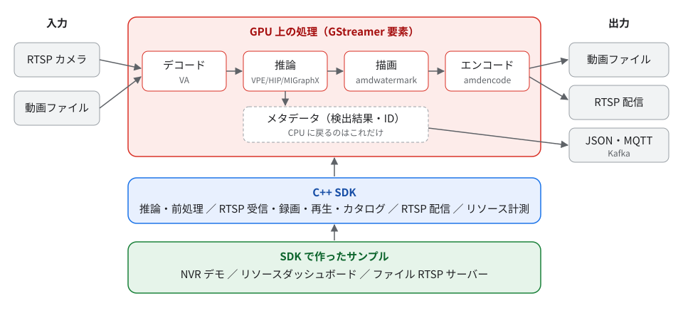

# AMD Video Analysis Framework

AMD の APU（Ryzen AI 9 HX 370 / Radeon 890M で検証）で、カメラ映像や動画ファイルの解析を行うための GStreamer フレームワークです。デコードから推論、描画、エンコードまでを GPU 上で処理し、CPU に戻すのは検出結果などのメタデータだけです。GStreamer の要素を `gst-launch-1.0` でつなぐだけで、物体検出、トラッキング、分類、セグメンテーション、姿勢推定を行い、結果を動画ファイルや RTSP、JSON として出力できます。

## できること

| 用途 | 使うもの |
| --- | --- |
| 動画やカメラ映像に検出結果を描画して保存・配信する | GStreamer 要素（`amddetect`、`amdwatermark`、`amdencode` など） |
| 検出結果を JSON や MQTT/Kafka で他のシステムに送る | `gvatrack`、`amdmetapublish` |
| 自分のアプリケーションに解析、録画、再生を組み込む | C++ SDK（CMake パッケージ） |
| 複数カメラの録画・監視・人物検索を試す | NVR デモ |

## 読む順番

1. [インストール](install.ja.md): 依存関係をビルドし、GPU の動作を確認します。
2. [クイックスタート](quickstart.ja.md): モデルを用意し、動画に検出結果を描画して保存します。
3. [仕組み](concepts.ja.md): データがどこを流れるか、要素とメタデータの役割を説明します。
4. 目的に応じて、[パイプラインの作り方](pipelines.ja.md)、[SDK でアプリケーションに組み込む](sdk.ja.md)、[NVR デモ](nvr-demo.ja.md) へ進みます。DL Streamer や DeepStream を使っていた場合は [他のフレームワークからの移行](migration.ja.md) を先に読んでください。

内部の設計、検証結果、すべてのプロパティの一覧は、[開発者向け情報](../dev/framework.ja.md) にまとめています。
