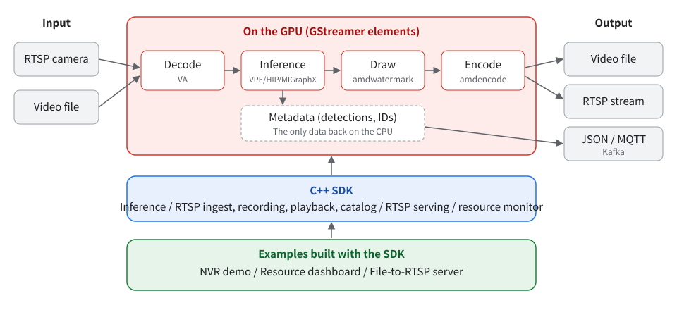

<!-- source: docs/guide/index.ja.md 2d17fcf9287c2ce4c5723d3def30a4292c2da3ff -->
# AMD Video Analytics Framework

A GStreamer framework for analyzing camera feeds and video files on AMD APUs (validated on Ryzen AI 9 HX 370 / Radeon 890M). Decoding, inference, drawing and encoding all run on the GPU; only metadata such as detection results returns to the CPU. By linking GStreamer elements with `gst-launch-1.0`, you can run object detection, tracking, classification, segmentation and pose estimation, and output the results as video files, RTSP streams or JSON.

## What you can do

| Use case | What to use |
| --- | --- |
| Draw detection results on video or camera feeds, then save or stream them | GStreamer elements (`amddetect`, `amdwatermark`, `amdencode`, etc.) |
| Send detection results to other systems as JSON or over MQTT/Kafka | `gvatrack`, `amdmetapublish` |
| Build analysis, recording and playback into your own application | C++ SDK (CMake package) |
| Try multi-camera recording, monitoring and person search | NVR demo |

## Reading order

1. [Installation](install.md): Build the dependencies and verify that the GPU works.
2. [Quick start](quickstart.md): Prepare a model, draw detection results on a video and save it.
3. [Concepts](concepts.md): Where the data flows, and the roles of elements and metadata.
4. Depending on your goal, continue with [Building pipelines](pipelines.md), [Embedding the SDK in your application](sdk.md) or the [NVR demo](nvr-demo.md). If you used DL Streamer or DeepStream, read [Migrating from other frameworks](migration.md) first.

Internal design, validation results and the full property list are in the [developer documentation](../dev/framework.md).
