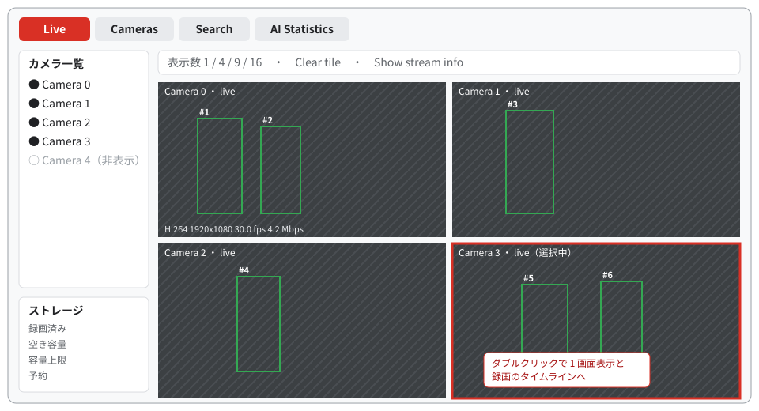
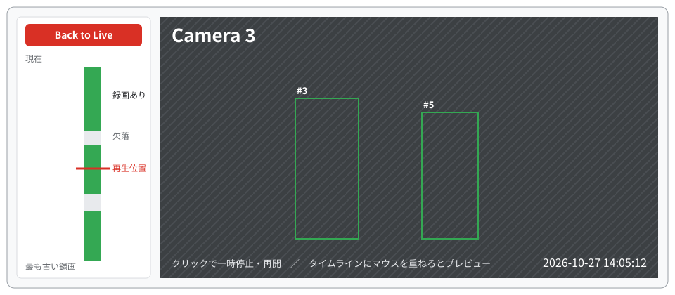
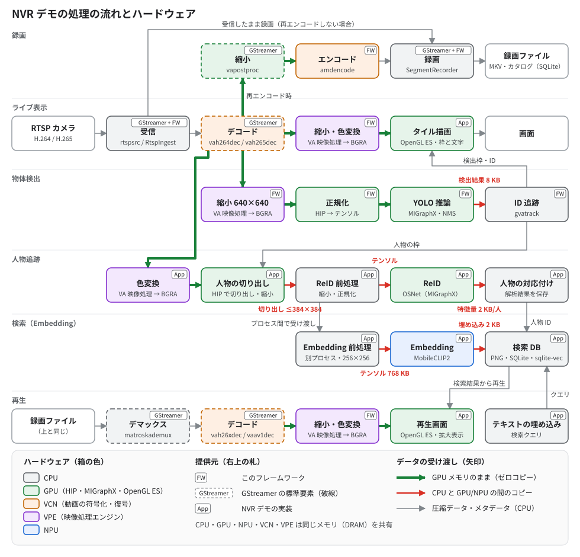

# NVR デモ

NVR デモは、このフレームワークで作ったネットワークビデオレコーダーのサンプルです。登録したすべての RTSP カメラを録画しながら、最大 16 台をデスクトップに表示し、表示中のカメラで人物や車両の検出とトラッキングを行います。録画はタイムラインから再生でき、ネイティブの埋め込みモデルを用意すれば人物を文章や画像で検索することもできます。

## 画面構成



| タブ | できること |
| --- | --- |
| Live | カメラを 1・4・9・16 分割のタイルに割り当てて表示します。検出枠とトラッキング ID を重ねて描画します |
| Cameras | カメラの追加・編集・削除、録画の保持期間の設定、録画の削除を行います |
| Search | 人物を文章、画像の領域、服装などの条件で検索します（別途セットアップが必要です） |
| AI Statistics | 推論の処理時間、検出の頻度、キューの状態を表示します |

タイルをダブルクリックすると 1 画面表示になり、左側の縦のタイムラインで録画を再生できます。



タイムラインの緑の区間をクリックするとその時刻から再生し、マウスを重ねるとその時刻のプレビューを表示します。**Back to Live** でライブ表示に戻ります。表示していないカメラも録画は続けます。

## 起動する

[インストール](install.ja.md) を終え、`source scripts/env.sh` を実行したシェルで作業します。デスクトップ（Wayland または X11）と、AMD の GPU による OpenGL ES 3 が必要です。

### 1. モデルを準備する

[クイックスタート](quickstart.ja.md) と同じ手順で、バッチサイズ 4 のモデルも作ります。

```bash
mkdir -p artifacts/nvr
curl -fsSL -o artifacts/nvr/yolov8n.pt \
  https://github.com/ultralytics/assets/releases/download/v8.3.0/yolov8n.pt
PATH="$PWD/build/src/gst:$PATH" .deps/model-export/bin/python \
  examples/nvr/scripts/export_nvr_model.py artifacts/nvr/yolov8n.pt artifacts/nvr/nvr-model --batch=4
```

`artifacts/nvr/nvr-model/` に `yolov8n-b4.mxr`、`yolov8n-b1.mxr`、`model-info.json` ができれば成功です。

### 2. カメラを用意する

RTSP カメラがない場合は、付属の `amdva-rtsp-files` で動画ファイルをカメラの代わりに配信できます。ファイルごとに 1 つの URL を割り当て、ファイルの終わりまで来ると先頭から繰り返します。別のターミナルで実行し、デモを使っている間は動かしたままにします。

```bash
build/examples/rtsp-files/amdva-rtsp-files --port 8558 \
  artifacts/quickstart/bus.h264 artifacts/quickstart/out.mp4
```

`rtsp://127.0.0.1:8558/cam0` と `rtsp://127.0.0.1:8558/cam1` が表示されれば成功です。入力は H.264 または H.265 の、プログレッシブ、8 ビット、2560×1440 以下の映像です。

### 3. 設定ファイルを作る

次の内容で `artifacts/nvr/nvr-local.json` を作ります。パスは設定ファイルからの相対パスです。

```json
{
  "model": "nvr-model/yolov8n-b4.mxr",
  "single_model": "nvr-model/yolov8n-b1.mxr",
  "model_info": "nvr-model/model-info.json",
  "recording_root": "nvr-recordings",
  "sources": [
    {"id": "cam0", "name": "Camera 0", "uri": "rtsp://127.0.0.1:8558/cam0", "selected": true},
    {"id": "cam1", "name": "Camera 1", "uri": "rtsp://127.0.0.1:8558/cam1", "selected": true}
  ]
}
```

カメラは起動後に **Cameras** タブからも追加できます。変更は設定ファイルに保存されます。

### 4. 起動する

```bash
WAYLAND_DISPLAY=wayland-0 QT_QPA_PLATFORM=wayland-egl \
  build/examples/nvr/amdva-nvr artifacts/nvr/nvr-local.json
```

X11 のデスクトップでは `QT_QPA_PLATFORM=xcb` を指定します。ウィンドウが開き、2 台のカメラの映像に検出枠と ID が表示されれば成功です。録画は `artifacts/nvr/nvr-recordings/` に保存されます。

起動するたびに、そのディレクトリにある以前の録画は削除されます。残したい録画は、起動の前に別の場所へ移してください。

## 画面を使わずに動かす

`amdva-streams` は、同じ設定ファイルで受信、録画、検出だけを行います。ディスプレイがなくても動き、1 秒ごとに状態を JSON で出力します。

```bash
build/examples/nvr/amdva-streams artifacts/nvr/nvr-local.json 20
```

20 秒間動作し、最後の行が `{"live":2,"recording":2,...}` となっていれば成功です。

## 人物検索

人物検索には、EmbeddingGemma 2 または MobileCLIP2 のネイティブランタイムが別途必要です。検索結果を同じ人物ごとのカードにまとめるには、さらに ReID モデル（OSNet）を用意します。準備の手順と設定項目は [人物検索](../dev/nvr/nvr-search.ja.md) を参照してください。

## 仕組み

NVR デモは、このフレームワークの部品、GStreamer の標準の要素、NVR デモ独自の実装を組み合わせて作っています。次の図は、カメラの映像がどう処理され、それぞれの処理がどのハードウェアで動くかを示します。各ハードウェアについては [仕組み](concepts.ja.md) の「Ryzen AI APU のハードウェア」を参照してください。人物検索の埋め込み（Embedding）は、MobileCLIP2 を NPU で計算する設定（`"embedding_model": "mobileclip2-s2"`、`"mobileclip_backend": "npu"`）の場合を示しています。

[](images/nvr-architecture-ja.svg)

図をクリックすると拡大して表示します。箱の色は処理を実行するハードウェア、右上の札は部品の提供元を表します。矢印の色はデータの受け渡し方で、緑は GPU のメモリのままの受け渡し（ゼロコピー）、赤は CPU と GPU または NPU の間のコピー、灰色は CPU のメモリにある圧縮データやメタデータです。

**受信と録画**: 受信した圧縮データを、CPU がそのまま MKV ファイルに書き込みます。映像をデコードしないので負荷が小さく、画面に表示していないカメラも録画を続けます。録画の再エンコードを設定したカメラは、デコードした映像を GPU で縮小し、VCN でエンコードしてから録画します（[再エンコード録画](../dev/nvr/vms.ja.md)）。

**ライブ表示と物体検出**: VCN でデコードした映像は、GPU のメモリから出ないまま、VPE で縮小と色の変換をされ、画面の表示（OpenGL ES）と物体検出（HIP、MIGraphX）に使われます。CPU に戻るのは検出結果（1 フレームあたり 8 KB）だけで、それを使って ID を割り当て、検出枠を描きます。

**人物追跡と検索**: 人物の特徴量（ReID）の前処理、検索用画像の保存、NPU への受け渡しは CPU で行うため、ここで初めて映像を CPU にコピーします。コピーするのは、GPU で人物の部分だけを切り出して縮小した小さな画像（最大 384×384）で、フレーム全体はコピーしません。ReID のモデルは GPU で、埋め込みのモデルは別のプロセスから NPU で動かします。検索の文章の埋め込みとベクトル検索は CPU で行います。

**再生**: 録画ファイルを CPU が読み込み、そこから先はライブ表示と同じく、VCN、VPE、GPU の間をゼロコピーで受け渡します。

| 処理 | ハードウェア | データの受け渡し | 提供元 |
| --- | --- | --- | --- |
| RTSP の受信 | CPU | 圧縮データ（CPU のメモリ） | GStreamer の `rtspsrc` と、フレームワークの `RtspIngest` |
| 録画 | CPU | 圧縮データのまま書き込み | GStreamer の `splitmuxsink` と、フレームワークの `SegmentRecorder`、`Catalog` |
| デコード | VCN | 映像を GPU のメモリ（NV12）に出力 | GStreamer の `vah264dec`、`vah265dec` |
| 表示用の縮小と色の変換 | VPE | ゼロコピー | フレームワーク |
| 画面の表示、検出枠と文字の描画 | GPU（OpenGL ES） | ゼロコピー | NVR デモ |
| 推論の入力への縮小 | VPE | ゼロコピー | フレームワーク |
| 正規化、推論（YOLO）、検出枠の絞り込み | GPU（HIP、MIGraphX） | ゼロコピー。検出結果だけ CPU に読み戻し（8 KB） | フレームワーク |
| ID の割り当て | CPU | メタデータだけ | フレームワーク（`gvatrack`） |
| 人物の切り出し | VPE、GPU（HIP） | 切り出した画像だけ CPU にコピー（最大 384×384） | NVR デモ |
| ReID | CPU、GPU（MIGraphX） | 入力を GPU に、特徴量（1 人 2 KB）を CPU にコピー | NVR デモ |
| 人物の対応付け、解析結果の保存 | CPU | — | NVR デモ、フレームワークの `Catalog` |
| 埋め込み（MobileCLIP2） | CPU（前処理）、NPU | 画像を別プロセスに渡し、入力を NPU にコピー | NVR デモ、ONNX Runtime と Ryzen AI ソフトウェア |
| 検索用画像の保存、ベクトル検索、文章の埋め込み | CPU | — | NVR デモ、SQLite と sqlite-vec |
| 再エンコード | GPU（縮小）、VCN | ゼロコピー。圧縮データだけ CPU へ | フレームワークの `Transcoder` と `amdencode`、GStreamer の `vapostproc` |
| 再生、タイムラインのプレビュー | CPU（読み込み）、VCN、VPE、GPU | 読み込み以降はゼロコピー | フレームワークの `PlaybackSession`、GStreamer の `matroskademux` |

提供元の「フレームワーク」は、このリポジトリの GStreamer プラグインと SDK ライブラリ（[SDK でアプリケーションに組み込む](sdk.ja.md)）、「NVR デモ」は `examples/nvr` の実装です。推論は MIGraphX、NPU での推論は ONNX Runtime と Ryzen AI ソフトウェアを使います。埋め込みに既定の EmbeddingGemma 2 を使う場合や、MobileCLIP2 を GPU で動かす場合は、埋め込みも GPU で計算します。処理の詳しい構成は [NVR の開発者向け情報](../dev/nvr/README.ja.md) を参照してください。

## さらに詳しく

- 設定項目、処理の構成、検証結果: [NVR の開発者向け情報](../dev/nvr/README.ja.md)
- 画面の操作と録画の管理: [デスクトップの映像管理](../dev/nvr/vms.ja.md)
