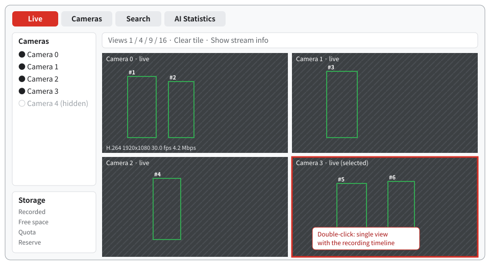
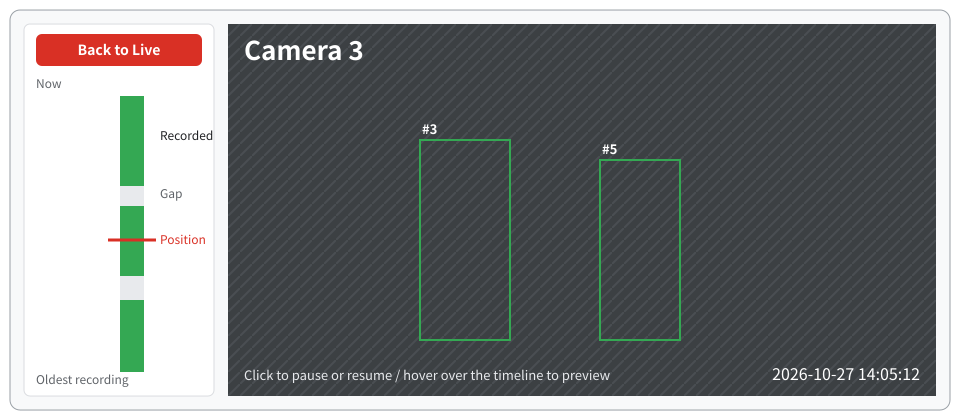

<!-- source: docs/guide/nvr-demo.ja.md 28e9d43bf79c15184f877e5fc43eaa4fce045a04 -->
# NVR demo

The NVR demo is a sample network video recorder built with this framework. It records all registered RTSP cameras while showing up to 16 of them on the desktop, and runs person and vehicle detection and tracking on the cameras being displayed. Recordings can be played back from a timeline, and if you prepare a native embedding model, you can also search for people by text or image.

## Screen layout



| Tab | What you can do |
| --- | --- |
| Live | Assign cameras to tiles in 1-, 4-, 9- or 16-way splits and view them. Bounding boxes and tracking IDs are drawn as an overlay |
| Cameras | Add, edit and delete cameras, set the recording retention period and delete recordings |
| Search | Search for people by text, an image region, or attributes such as clothing (requires separate setup) |
| AI Statistics | Shows inference processing time, detection frequency and queue status |

Double-click a tile to switch to single view, where you can play back recordings from the vertical timeline on the left.



Click a green segment on the timeline to start playback from that time; hover over it to see a preview of that time. **Back to Live** returns to the live view. Cameras that are not displayed continue recording.

## Launch

Complete the [Installation](install.md) first, and work in a shell where you have run `source scripts/env.sh`. A desktop (Wayland or X11) and OpenGL ES 3 on the AMD GPU are required.

### 1. Prepare the model

Using the same steps as the [Quick start](quickstart.md), also create a model with batch size 4.

```bash
mkdir -p artifacts/nvr
curl -fsSL -o artifacts/nvr/yolov8n.pt \
  https://github.com/ultralytics/assets/releases/download/v8.3.0/yolov8n.pt
PATH="$PWD/build/src/gst:$PATH" .deps/model-export/bin/python \
  examples/nvr/scripts/export_nvr_model.py artifacts/nvr/yolov8n.pt artifacts/nvr/nvr-model --batch=4
```

This step succeeded if `yolov8n-b4.mxr`, `yolov8n-b1.mxr` and `model-info.json` appear in `artifacts/nvr/nvr-model/`.

### 2. Prepare cameras

If you have no RTSP cameras, the bundled `amdva-rtsp-files` can serve video files in place of cameras. It assigns one URL per file and loops back to the start when it reaches the end of a file. Run it in a separate terminal and keep it running while you use the demo.

```bash
build/examples/rtsp-files/amdva-rtsp-files --port 8558 \
  artifacts/quickstart/bus.h264 artifacts/quickstart/out.mp4
```

It succeeded if `rtsp://127.0.0.1:8558/cam0` and `rtsp://127.0.0.1:8558/cam1` are printed. Input must be H.264 or H.265 video that is progressive, 8-bit and 2560×1440 or smaller.

### 3. Create a configuration file

Create `artifacts/nvr/nvr-local.json` with the following content. Paths are relative to the configuration file.

```json
{
  "model": "nvr-model/yolov8n-b4.mxr",
  "single_model": "nvr-model/yolov8n-b1.mxr",
  "model_info": "nvr-model/model-info.json",
  "recording_root": "nvr-recordings",
  "sources": [
    {"id": "cam0", "name": "Camera 0", "uri": "rtsp://127.0.0.1:8558/cam0", "selected": true},
    {"id": "cam1", "name": "Camera 1", "uri": "rtsp://127.0.0.1:8558/cam1", "selected": true}
  ]
}
```

You can also add cameras from the **Cameras** tab after launch. Changes are saved to the configuration file.

### 4. Launch

```bash
WAYLAND_DISPLAY=wayland-0 QT_QPA_PLATFORM=wayland-egl \
  build/examples/nvr/amdva-nvr artifacts/nvr/nvr-local.json
```

On an X11 desktop, specify `QT_QPA_PLATFORM=xcb`. It succeeded if a window opens and bounding boxes and IDs appear on the video from the two cameras. Recordings are saved to `artifacts/nvr/nvr-recordings/`.

Each launch deletes previous recordings in that directory. Move any recordings you want to keep to another location before launching.

## Run headless

`amdva-streams` uses the same configuration file and performs only ingest, recording and detection. It runs without a display and prints its status as JSON every second.

```bash
build/examples/nvr/amdva-streams artifacts/nvr/nvr-local.json 20
```

It runs for 20 seconds, and it succeeded if the last line is `{"live":2,"recording":2,...}`.

## Person search

Person search requires a separate native runtime for EmbeddingGemma 2 or MobileCLIP2. To group search results into one card per person, you also need a ReID model (OSNet). For setup steps and settings, see [Person search](../dev/nvr/nvr-search.md).

## Further reading

- Settings, processing architecture, validation results: [NVR developer documentation](../dev/nvr/README.md)
- Screen operations and recording management: [Desktop video management](../dev/nvr/vms.md)
