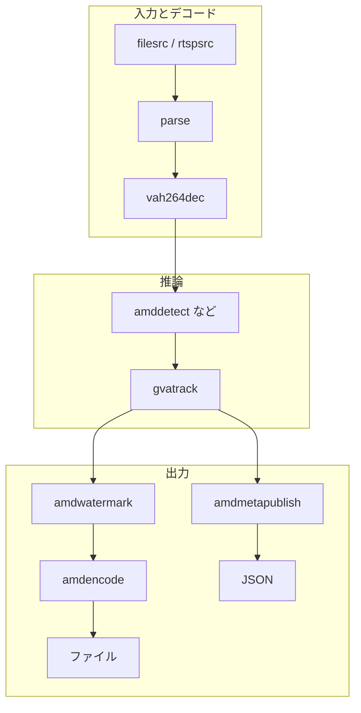
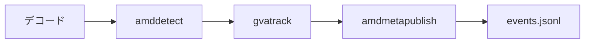
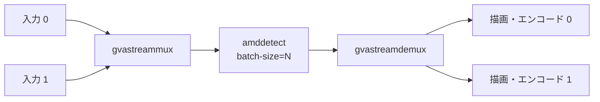

# パイプラインの作り方

GStreamer の要素を `!` でつなぎ、`gst-launch-1.0` で実行します。どのパイプラインも「入力とデコード」「推論」「出力」の 3 つの部分からなり、目的に応じて推論と出力の要素を入れ替えます。このページの例は、[クイックスタート](quickstart.ja.md) で作ったモデルと動画を使い、すべてこのリポジトリの検証環境で動作を確認しています。



以下の例は、次の環境変数を設定したシェルで実行します。

```bash
source scripts/env.sh
Q=artifacts/quickstart
DETECT="amddetect model=$Q/model/yolov8n-b1.mxr model-info=$Q/model/model-info.json"
```

## 入力とデコード

推論の要素が受け付けるのは、GPU 上の NV12（`video/x-raw(memory:VAMemory),format=NV12`）です。デコーダーの後にこの caps を書いておくと、つなぎ方の誤りが起動時に分かります。

| 入力 | 入力とデコードの部分 |
| --- | --- |
| H.264 のファイル（`.h264`） | `filesrc location=in.h264 ! h264parse ! video/x-h264,framerate=30/1 ! vah264dec ! 'video/x-raw(memory:VAMemory),format=NV12'` |
| MP4 のファイル | `filesrc location=in.mp4 ! qtdemux ! h264parse ! vah264dec ! 'video/x-raw(memory:VAMemory),format=NV12'` |
| RTSP カメラ（H.264） | `rtspsrc location=rtsp://<カメラ>/<パス> protocols=tcp ! rtph264depay ! h264parse ! vah264dec ! 'video/x-raw(memory:VAMemory),format=NV12'` |

`.h264` ファイルにはタイムスタンプがないため、`video/x-h264,framerate=30/1` でフレームレートを指定します。MP4 と RTSP では不要です。H.265 の場合は `h265parse` と `vah265dec`（RTSP では `rtph265depay`）に置き換えます。

## 検出結果を JSON で受け取る

`gvatrack` で物体に ID を付け、`amdmetapublish` で 1 フレーム 1 行の JSON をファイルに書き出します。



```bash
gst-launch-1.0 -e filesrc location=$Q/bus.h264 ! h264parse ! video/x-h264,framerate=30/1 ! \
  vah264dec ! 'video/x-raw(memory:VAMemory),format=NV12' ! $DETECT ! \
  gvatrack tracking-type=short-term-imageless ! \
  amdmetapublish method=file file-path=$Q/events.jsonl ! fakesink
```

`events.jsonl` に 90 行が書き込まれます。各行の `objects` に、クラス、信頼度、枠（ピクセル座標）、トラッキング ID が入ります（以下は 1 行の一部です）。

```json
{"schema":1,"pts_ns":0,"objects":[
  {"label":"person","confidence":0.896,"x":1595,"y":388,"width":325,"height":481,"tracking_id":1},
  {"label":"bus","confidence":0.311,"x":10,"y":234,"width":1898,"height":513,"tracking_id":6}]}
```

MQTT や Kafka に送る場合は、`method=mqtt address=tcp://<ブローカー>:1883 topic=<トピック>` または `method=kafka address=<ブローカー>:9092 topic=<トピック>` を指定します。送信はブローカーの障害で映像処理を止めない非同期方式で、キューがあふれた場合は古いレコードから捨てます。実際のブローカーとの接続はこの検証環境では確認していません（テストではローカルの模擬ブローカーを使っています）。

## 検出した物体を分類する

`amdclassify` は、上流で検出した物体の領域を切り出して分類します。分類、セグメンテーション、姿勢推定のモデルは、次の手順でまとめて準備できます。

```bash
.deps/model-export/bin/python scripts/export_analytics_models.py $Q/models
for name in resnet18 yolov8n-seg yolov8n-pose segformer-b0; do
  build/src/gst/amdva-compile-model $Q/models/$name.onnx $Q/models/$name.mxr \
    --model-info=$Q/models/$name.json
done
```

`$Q/models/` に `resnet18.mxr`、`yolov8n-seg.mxr`、`yolov8n-pose.mxr`、`segformer-b0.mxr` とそれぞれの JSON ができれば成功です。

```bash
gst-launch-1.0 -e filesrc location=$Q/bus.h264 ! h264parse ! video/x-h264,framerate=30/1 ! \
  vah264dec ! 'video/x-raw(memory:VAMemory),format=NV12' ! $DETECT ! \
  gvatrack tracking-type=short-term-imageless ! \
  amdclassify model=$Q/models/resnet18.mxr model-info=$Q/models/resnet18.json ! \
  amdmetapublish method=file file-path=$Q/classify.jsonl ! fakesink
```

JSON の各物体の `classifications` に、ImageNet のクラス名と信頼度が入ります。フレーム全体を分類する場合は、`amdclassify` に `inference-region=full-frame` を指定します。

## セグメンテーションと姿勢推定

検出の要素に渡すモデルを替えるだけで使えます。描画まで行う例です。

| 処理 | 推論の要素 | 結果 |
| --- | --- | --- |
| インスタンスセグメンテーション | `amddetect model=$Q/models/yolov8n-seg.mxr model-info=$Q/models/yolov8n-seg.json` | 物体ごとのマスク。`amdwatermark` が色を付けて描画します |
| 姿勢推定 | `amddetect model=$Q/models/yolov8n-pose.mxr model-info=$Q/models/yolov8n-pose.json` | 人物ごとに 17 点のキーポイント。`amdwatermark` が骨格を描画します |
| セマンティックセグメンテーション | `amdinference model=$Q/models/segformer-b0.mxr model-info=$Q/models/segformer-b0.json` | 画素ごとのクラス（GPU 上のテンソル） |

```bash
gst-launch-1.0 -e filesrc location=$Q/bus.h264 ! h264parse ! video/x-h264,framerate=30/1 ! \
  vah264dec ! 'video/x-raw(memory:VAMemory),format=NV12' ! \
  amddetect model=$Q/models/yolov8n-seg.mxr model-info=$Q/models/yolov8n-seg.json ! \
  amdwatermark ! amdencode ! h264parse ! mp4mux ! filesink location=$Q/seg.mp4
```

マスクは GPU 上に置いたまま描画され、JSON にはマスクの画素ではなくテンソルの形だけが記録されます。

## Python で結果を処理する

`amdpython` は、フレームごとに Python の関数へ検出結果の辞書を渡します。関数が辞書を返すと、その内容が JSON の `custom` に入ります。`False` を返すとそのフレームを捨てます。画素は渡されません。

```python
# examples/metadata_callback.py
def process(frame):
    people = [obj for obj in frame['objects'] if obj['label'] == 'person']
    return {'people': len(people),
            'tracked_people': [obj['tracking_id'] for obj in people if 'tracking_id' in obj]}
```

```bash
gst-launch-1.0 -e filesrc location=$Q/bus.h264 ! h264parse ! video/x-h264,framerate=30/1 ! \
  vah264dec ! 'video/x-raw(memory:VAMemory),format=NV12' ! $DETECT ! \
  gvatrack tracking-type=short-term-imageless ! \
  amdpython module=$PWD/examples/metadata_callback.py ! \
  amdmetapublish method=file file-path=$Q/python.jsonl ! fakesink
```

各行に `"custom":{"people":4,"tracked_people":[1,2,3,4]}` のような値が加わります。関数は映像処理のスレッドで実行されるため、時間のかかる処理を書くとフレームレートが下がります。

## 複数の映像をまとめて推論する

`gvastreammux` で複数の入力を 1 つにまとめると、1 つの推論要素がバッチで処理し、`gvastreamdemux` で入力ごとに分け直します。解像度が異なる入力もまとめられます。



付属のレシピで 2 本の動画を処理します。

```bash
VIDEO=$Q/bus.h264 VIDEO2=$Q/bus.h264 \
MODEL=$Q/model/yolov8n-b1.mxr MODEL_INFO=$Q/model/model-info.json \
  examples/pipelines/multistream-encode.sh $Q/out0.mkv $Q/out1.mkv
```

`out0.mkv` と `out1.mkv` に、それぞれ検出結果を描画した 90 フレームが出力されます。入力の数に合わせてバッチサイズを上げる場合は、その値でコンパイルしたモデルを使い、`BATCH_SIZE` を指定します。

## 次に読むページ

- 処理した映像を RTSP で配信する、アプリケーションに組み込む: [SDK でアプリケーションに組み込む](sdk.ja.md)
- すべての要素とプロパティ: [要素リファレンス](../dev/elements.ja.md)
