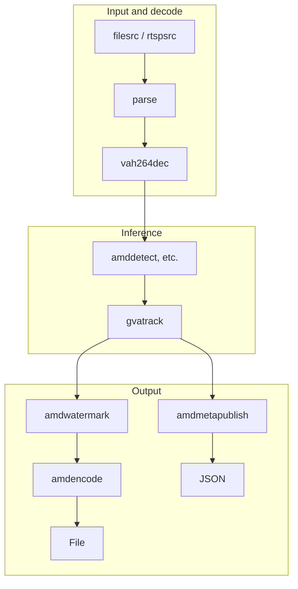
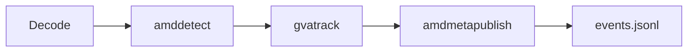
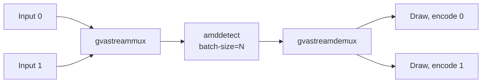

<!-- source: docs/guide/pipelines.ja.md cf8b668570a7b7ffea26840abcad9dc793275bff -->
# Building pipelines

Link GStreamer elements with `!` and run them with `gst-launch-1.0`. Every pipeline consists of three parts, "input and decode", "inference" and "output", and you swap the inference and output elements depending on your goal. The examples on this page use the model and video created in the [Quick start](quickstart.md), and all of them have been verified in this repository's validation environment.



Run the following examples in a shell with these environment variables set.

```bash
source scripts/env.sh
Q=artifacts/quickstart
DETECT="amddetect model=$Q/model/yolov8n-b1.mxr model-info=$Q/model/model-info.json"
```

## Input and decode

Inference elements accept NV12 on the GPU (`video/x-raw(memory:VAMemory),format=NV12`). Writing these caps after the decoder makes linking errors show up at startup.

| Input | Input and decode part |
| --- | --- |
| H.264 file (`.h264`) | `filesrc location=in.h264 ! h264parse ! video/x-h264,framerate=30/1 ! vah264dec ! 'video/x-raw(memory:VAMemory),format=NV12'` |
| MP4 file | `filesrc location=in.mp4 ! qtdemux ! h264parse ! vah264dec ! 'video/x-raw(memory:VAMemory),format=NV12'` |
| RTSP camera (H.264) | `rtspsrc location=rtsp://<camera>/<path> protocols=tcp ! rtph264depay ! h264parse ! vah264dec ! 'video/x-raw(memory:VAMemory),format=NV12'` |

`.h264` files have no timestamps, so specify the frame rate with `video/x-h264,framerate=30/1`. This is not needed for MP4 and RTSP. For H.265, replace these with `h265parse` and `vah265dec` (and `rtph265depay` for RTSP).

## Receive detection results as JSON

Assign IDs to objects with `gvatrack`, and write one line of JSON per frame to a file with `amdmetapublish`.



```bash
gst-launch-1.0 -e filesrc location=$Q/bus.h264 ! h264parse ! video/x-h264,framerate=30/1 ! \
  vah264dec ! 'video/x-raw(memory:VAMemory),format=NV12' ! $DETECT ! \
  gvatrack tracking-type=short-term-imageless ! \
  amdmetapublish method=file file-path=$Q/events.jsonl ! fakesink
```

90 lines are written to `events.jsonl`. The `objects` field of each line contains the class, confidence, box (in pixel coordinates) and tracking ID (below is part of one line).

```json
{"schema":1,"pts_ns":0,"objects":[
  {"label":"person","confidence":0.896,"x":1595,"y":388,"width":325,"height":481,"tracking_id":1},
  {"label":"bus","confidence":0.311,"x":10,"y":234,"width":1898,"height":513,"tracking_id":6}]}
```

To publish to MQTT or Kafka, specify `method=mqtt address=tcp://<broker>:1883 topic=<topic>` or `method=kafka address=<broker>:9092 topic=<topic>`. Publishing is asynchronous so that broker failures do not stop video processing; when the queue overflows, the oldest records are dropped first. Connections to real brokers have not been verified in this validation environment (the tests use a local mock broker).

## Classify detected objects

`amdclassify` crops the regions of objects detected upstream and classifies them. You can prepare the classification, segmentation and pose estimation models together with the following steps.

```bash
.deps/model-export/bin/python scripts/export_analytics_models.py $Q/models
for name in resnet18 yolov8n-seg yolov8n-pose segformer-b0; do
  build/src/gst/amdva-compile-model $Q/models/$name.onnx $Q/models/$name.mxr \
    --model-info=$Q/models/$name.json
done
```

This step succeeded if `resnet18.mxr`, `yolov8n-seg.mxr`, `yolov8n-pose.mxr`, `segformer-b0.mxr` and their JSON files appear in `$Q/models/`.

```bash
gst-launch-1.0 -e filesrc location=$Q/bus.h264 ! h264parse ! video/x-h264,framerate=30/1 ! \
  vah264dec ! 'video/x-raw(memory:VAMemory),format=NV12' ! $DETECT ! \
  gvatrack tracking-type=short-term-imageless ! \
  amdclassify model=$Q/models/resnet18.mxr model-info=$Q/models/resnet18.json ! \
  amdmetapublish method=file file-path=$Q/classify.jsonl ! fakesink
```

The `classifications` field of each object in the JSON contains the ImageNet class name and confidence. To classify the whole frame, specify `inference-region=full-frame` on `amdclassify`.

## Segmentation and pose estimation

Just change the model passed to the detection element. This example includes drawing.

| Task | Inference element | Result |
| --- | --- | --- |
| Instance segmentation | `amddetect model=$Q/models/yolov8n-seg.mxr model-info=$Q/models/yolov8n-seg.json` | A mask per object. `amdwatermark` draws it in color |
| Pose estimation | `amddetect model=$Q/models/yolov8n-pose.mxr model-info=$Q/models/yolov8n-pose.json` | 17 keypoints per person. `amdwatermark` draws the skeleton |
| Semantic segmentation | `amdinference model=$Q/models/segformer-b0.mxr model-info=$Q/models/segformer-b0.json` | A class per pixel (a tensor on the GPU) |

```bash
gst-launch-1.0 -e filesrc location=$Q/bus.h264 ! h264parse ! video/x-h264,framerate=30/1 ! \
  vah264dec ! 'video/x-raw(memory:VAMemory),format=NV12' ! \
  amddetect model=$Q/models/yolov8n-seg.mxr model-info=$Q/models/yolov8n-seg.json ! \
  amdwatermark ! amdencode ! h264parse ! mp4mux ! filesink location=$Q/seg.mp4
```

Masks are drawn while staying on the GPU, and the JSON records only the tensor shape, not the mask pixels.

## Process results in Python

`amdpython` passes a dictionary of detection results to a Python function for each frame. If the function returns a dictionary, its contents go into `custom` in the JSON. Returning `False` drops that frame. Pixels are not passed.

```python
# examples/metadata_callback.py
def process(frame):
    people = [obj for obj in frame['objects'] if obj['label'] == 'person']
    return {'people': len(people),
            'tracked_people': [obj['tracking_id'] for obj in people if 'tracking_id' in obj]}
```

```bash
gst-launch-1.0 -e filesrc location=$Q/bus.h264 ! h264parse ! video/x-h264,framerate=30/1 ! \
  vah264dec ! 'video/x-raw(memory:VAMemory),format=NV12' ! $DETECT ! \
  gvatrack tracking-type=short-term-imageless ! \
  amdpython module=$PWD/examples/metadata_callback.py ! \
  amdmetapublish method=file file-path=$Q/python.jsonl ! fakesink
```

Each line gets a value such as `"custom":{"people":4,"tracked_people":[1,2,3,4]}`. The function runs on the video processing thread, so slow code lowers the frame rate.

## Batch inference over multiple streams

Combine multiple inputs into one with `gvastreammux`, let a single inference element process them as a batch, and split them back per input with `gvastreamdemux`. Inputs with different resolutions can be combined.



Process two videos with the bundled recipe.

```bash
VIDEO=$Q/bus.h264 VIDEO2=$Q/bus.h264 \
MODEL=$Q/model/yolov8n-b1.mxr MODEL_INFO=$Q/model/model-info.json \
  examples/pipelines/multistream-encode.sh $Q/out0.mkv $Q/out1.mkv
```

`out0.mkv` and `out1.mkv` each receive 90 frames with detection results drawn. To raise the batch size to match the number of inputs, use a model compiled with that value and set `BATCH_SIZE`.

## Next steps

- Serve processed video over RTSP, embed in an application: [Embedding the SDK in your application](sdk.md)
- All elements and properties: [Element reference](../dev/elements.md)
