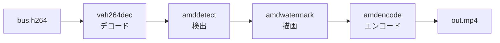

# クイックスタート

YOLOv8n で人物や車両を検出し、検出枠とラベルを描画した MP4 を作ります。モデルの準備に 1 分ほど、動画の処理に数秒かかります。



[インストール](install.ja.md) を終え、リポジトリのルートで `source scripts/env.sh` を実行したシェルで作業します。作業用のファイルは `artifacts/quickstart/` に置きます（`artifacts/` は Git の管理対象外です）。

## 1. モデルを準備する

YOLOv8n の重みをダウンロードし、ONNX に変換してから、この GPU 向けにコンパイルします。変換には CPU だけを使う専用の Python 環境を使います。

```bash
python3 scripts/setup_model_export.py
mkdir -p artifacts/quickstart
curl -fsSL -o artifacts/quickstart/yolov8n.pt \
  https://github.com/ultralytics/assets/releases/download/v8.3.0/yolov8n.pt
PATH="$PWD/build/src/gst:$PATH" .deps/model-export/bin/python \
  examples/nvr/scripts/export_nvr_model.py \
  artifacts/quickstart/yolov8n.pt artifacts/quickstart/model --batch=1
```

`artifacts/quickstart/model/` に次のファイルができれば成功です。

| ファイル | 内容 |
| --- | --- |
| `yolov8n-b1.mxr` | コンパイル済みモデル（バッチサイズ 1） |
| `yolov8n-b1.mxr.manifest.json` | モデルのハッシュと対象 GPU。一致しないモデルは読み込み時に拒否されます |
| `model-info.json` | 入力の形と前処理、出力の形式を記述した設定 |
| `coco80.txt` | クラス名（80 行） |

YOLOv8n の重みには Ultralytics のライセンスが適用されます。配布や商用利用の前に条件を確認してください。

## 2. テスト用の動画を作る

Ultralytics のサンプル画像から、3 秒・30fps の H.264 を作ります。手元の H.264 ファイルを使う場合は、この手順を飛ばしてください。

```bash
curl -fsSL -o artifacts/quickstart/bus.jpg \
  https://raw.githubusercontent.com/ultralytics/ultralytics/main/ultralytics/assets/bus.jpg
ffmpeg -loop 1 -i artifacts/quickstart/bus.jpg -t 3 -r 30 \
  -vf 'scale=1920:1080:out_color_matrix=bt709:out_range=limited' \
  -c:v libx264 -pix_fmt yuv420p -color_primaries bt709 -color_trc bt709 -colorspace bt709 \
  -f h264 artifacts/quickstart/bus.h264
```

## 3. 検出結果を描画して保存する

付属のレシピスクリプトは、デコードからエンコードまでの GStreamer パイプラインを組み立てて実行します。

```bash
VIDEO=artifacts/quickstart/bus.h264 \
MODEL=artifacts/quickstart/model/yolov8n-b1.mxr \
MODEL_INFO=artifacts/quickstart/model/model-info.json \
  examples/pipelines/annotate-to-file.sh artifacts/quickstart/out.mp4
```

スクリプトは実行する `gst-launch-1.0` のコマンドを表示し、`Execution ended after ...` と出力して終了します。出力を確認します。

```bash
ffprobe -v error -count_frames -select_streams v \
  -show_entries stream=codec_name,width,height,nb_read_frames -of csv=p=0 \
  artifacts/quickstart/out.mp4
```

`h264,1920,1080,90` と表示されれば成功です。`out.mp4` を動画プレーヤーで開くと、人物とバスに検出枠とラベルが描画されています。

## 次に読むページ

- 検出結果を JSON で受け取る、トラッキングを加える、カメラ映像を入力にする: [パイプラインの作り方](pipelines.ja.md)
- データが GPU 上をどう流れるか: [仕組み](concepts.ja.md)
