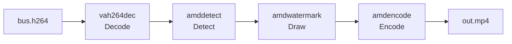

<!-- source: docs/guide/quickstart.ja.md 59c190a5700f707f0c1e56f635d50fc28aa8c8f2 -->
# Quick start

Detect people and vehicles with YOLOv8n and create an MP4 with bounding boxes and labels drawn on it. Preparing the model takes about a minute, and processing the video takes a few seconds.



Complete the [Installation](install.md) first, and work in a shell at the repository root where you have run `source scripts/env.sh`. Working files go in `artifacts/quickstart/` (`artifacts/` is not tracked by Git).

## 1. Prepare the model

Download the YOLOv8n weights, convert them to ONNX, then compile the model for this GPU. The conversion uses a dedicated CPU-only Python environment.

```bash
python3 scripts/setup_model_export.py
mkdir -p artifacts/quickstart
curl -fsSL -o artifacts/quickstart/yolov8n.pt \
  https://github.com/ultralytics/assets/releases/download/v8.3.0/yolov8n.pt
PATH="$PWD/build/src/gst:$PATH" .deps/model-export/bin/python \
  examples/nvr/scripts/export_nvr_model.py \
  artifacts/quickstart/yolov8n.pt artifacts/quickstart/model --batch=1
```

This step succeeded if the following files appear in `artifacts/quickstart/model/`.

| File | Contents |
| --- | --- |
| `yolov8n-b1.mxr` | Compiled model (batch size 1) |
| `yolov8n-b1.mxr.manifest.json` | Model hash and target GPU. A model that does not match is rejected at load time |
| `model-info.json` | Configuration describing the input shape, preprocessing and output format |
| `coco80.txt` | Class names (80 lines) |

The YOLOv8n weights are subject to the Ultralytics license. Check its terms before redistribution or commercial use.

## 2. Create a test video

Create a 3-second, 30 fps H.264 stream from an Ultralytics sample image. If you use your own H.264 file, skip this step.

```bash
curl -fsSL -o artifacts/quickstart/bus.jpg \
  https://raw.githubusercontent.com/ultralytics/ultralytics/main/ultralytics/assets/bus.jpg
ffmpeg -loop 1 -i artifacts/quickstart/bus.jpg -t 3 -r 30 \
  -vf 'scale=1920:1080:out_color_matrix=bt709:out_range=limited' \
  -c:v libx264 -pix_fmt yuv420p -color_primaries bt709 -color_trc bt709 -colorspace bt709 \
  -f h264 artifacts/quickstart/bus.h264
```

## 3. Draw detection results and save the video

The bundled recipe script builds and runs a GStreamer pipeline from decoding to encoding.

```bash
VIDEO=artifacts/quickstart/bus.h264 \
MODEL=artifacts/quickstart/model/yolov8n-b1.mxr \
MODEL_INFO=artifacts/quickstart/model/model-info.json \
  examples/pipelines/annotate-to-file.sh artifacts/quickstart/out.mp4
```

The script prints the `gst-launch-1.0` command it runs, prints `Execution ended after ...` and exits. Check the output.

```bash
ffprobe -v error -count_frames -select_streams v \
  -show_entries stream=codec_name,width,height,nb_read_frames -of csv=p=0 \
  artifacts/quickstart/out.mp4
```

It succeeded if `h264,1920,1080,90` is printed. Open `out.mp4` in a video player to see bounding boxes and labels drawn on the people and the bus.

## Next steps

- Receive detection results as JSON, add tracking, use a camera feed as input: [Building pipelines](pipelines.md)
- How data flows on the GPU: [Concepts](concepts.md)
