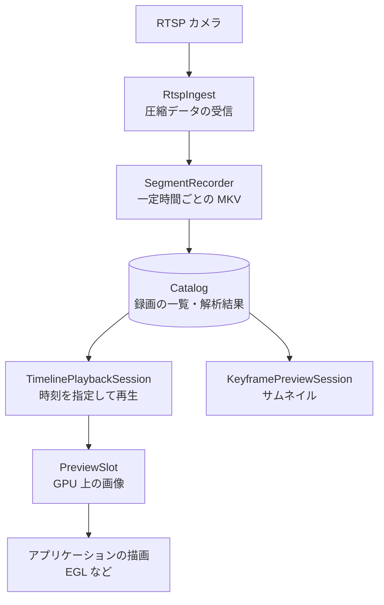

# SDK でアプリケーションに組み込む

フレームワークをインストールすると、CMake の `find_package(AMDVideoAnalytics)` で C++ のライブラリを使えます。GStreamer のパイプラインを自分のプログラムから動かすほか、RTSP カメラの受信、録画、録画の検索と再生、処理した映像の RTSP 配信を、Qt などの GUI ライブラリに依存せずに組み込めます。このページでは、SDK のインストール、付属サンプルのビルドと実行、主な API の構成を説明します。

## 1. SDK をインストールする

[インストール](install.ja.md) でビルドした `build/` から、任意の場所へインストールします。

```bash
cmake --install build --prefix <インストール先>
```

`<インストール先>` に `include/amdva/`、`lib/`（ライブラリと `gstreamer-1.0/` のプラグイン）、`lib/cmake/AMDVideoAnalytics/` ができれば成功です。

## 2. 付属サンプルをビルドする

`examples/sdk/` は、インストールした SDK だけを使う独立した CMake プロジェクトです。

```bash
cmake -S examples/sdk -B build-sdk -DCMAKE_PREFIX_PATH="<インストール先>;$CMAKE_PREFIX_PATH"
cmake --build build-sdk -j8
```

`build-sdk/` に `transcode`、`telemetry`、`playback`、`timeline`、`keyframe-preview` ができれば成功です。自分のプロジェクトでは、次のように書きます。

```cmake
find_package(AMDVideoAnalytics REQUIRED)
add_executable(app main.cpp)
target_link_libraries(app PRIVATE AMDVA::amdva_streaming)
```

## 3. サンプルを実行する

インストール先がシステム標準の場所でない場合は、ライブラリとプラグインの場所を指定します。

```bash
export LD_LIBRARY_PATH=<インストール先>/lib:$LD_LIBRARY_PATH
export GST_PLUGIN_PATH=<インストール先>/lib/gstreamer-1.0:$GST_PLUGIN_PATH
```

`transcode` は、動画をデコードして検出結果を描画し、ファイルに保存するか RTSP で配信します。[クイックスタート](quickstart.ja.md) のモデルと動画を使う例です。

```bash
Q=artifacts/quickstart
build-sdk/transcode $Q/bus.h264 $Q/model/yolov8n-b1.mxr $Q/model/model-info.json \
  --rtsp 8554 --mount /annotated
```

`rtsp://127.0.0.1:8554/annotated` と表示され、VLC や `ffplay` などのプレーヤーで受信できます。`--rtsp` の代わりに `--output out.mp4` を指定するとファイルに保存します。

| サンプル | 内容 | 引数 |
| --- | --- | --- |
| `transcode` | デコード、検出、描画、エンコードして保存または RTSP 配信 | `IN.h264 MODEL.mxr MODEL_INFO.json (--output FILE \| --rtsp PORT [--mount PATH])` |
| `telemetry` | RTSP の受信からデコードまでの遅延とフレームレートの計測 | `RTSP_URI [SECONDS] [h264\|h265]` |
| `playback` | 録画ファイル 1 つの再生 | `RECORDING_ROOT RECORDING_NAME` |
| `timeline` | カメラの録画を時刻順につないで再生 | `RECORDING_ROOT CAMERA_ID` |
| `keyframe-preview` | 指定時刻に近いキーフレームのプレビュー画像の生成 | `RECORDING_ROOT CAMERA_ID UNIX_MS` |

`playback`、`timeline`、`keyframe-preview` が使う録画のディレクトリは、次の節の録画 API や [NVR デモ](nvr-demo.ja.md) で作れます。動作中のアプリケーションが使っているディレクトリは指定しないでください。録画のカタログは 1 つのプロセスだけが開けます。

## 録画と再生の API

`amdva_streaming` ライブラリは、カメラの受信から録画、検索、再生までを部品として提供します。映像は再エンコードせずに保存し、再生した映像は GPU 上の画像としてアプリケーションに渡します。



| クラス | 役割 |
| --- | --- |
| `RtspIngest` | RTSP カメラ 1 台から H.264/H.265 の圧縮データを受け取り、上限のあるキューに入れます。再接続の方針はアプリケーションが決めます |
| `SegmentRecorder` | 圧縮データを一定時間ごとの MKV ファイルに保存し、カタログに登録します |
| `Catalog` | 録画ファイルと解析結果を SQLite で管理します。容量の上限を超えた分の古い録画の削除と、指定した時刻より前の録画の削除を提供します |
| `PlaybackSession`、`TimelinePlaybackSession` | 録画をハードウェアでデコードして再生します。タイムライン版は、ファイルの切れ目と録画のない時間を自動で飛ばします |
| `KeyframePreviewSession` | 指定時刻のプレビュー画像を GPU 上に作ります |

これらの組み合わせ方の実例が、[NVR デモ](nvr-demo.ja.md) のバックエンドです。各クラスの詳細とスレッドの扱いは、[SDK ガイド](../dev/sdk-guide.ja.md) と [VMS のインターフェース](../dev/nvr/vms.ja.md#framework-interfaces-and-migration) を参照してください。
