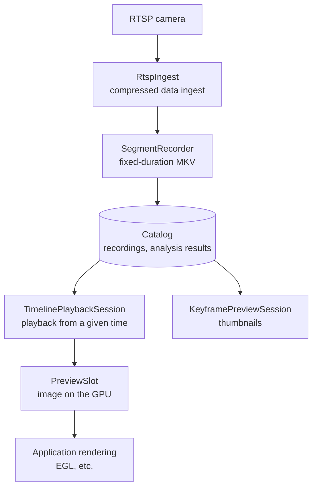

<!-- source: docs/guide/sdk.ja.md cbeaa691527bab43ee74fdb00aa8cce85c22bad1 -->
# Embedding the SDK in your application

After you install the framework, you can use its C++ libraries through CMake's `find_package(AMDVideoAnalysis)`. Besides running GStreamer pipelines from your own program, you can embed RTSP camera ingest, recording, recording search and playback, and RTSP serving of processed video, without depending on GUI libraries such as Qt. This page covers installing the SDK, building and running the bundled samples, and the structure of the main APIs.

## 1. Install the SDK

Install from the `build/` directory built in [Installation](install.md) to any location.

```bash
cmake --install build --prefix <prefix>
```

The installation succeeded if `include/amdva/`, `lib/` (the libraries and the `gstreamer-1.0/` plugins) and `lib/cmake/AMDVideoAnalysis/` appear under `<prefix>`.

## 2. Build the bundled samples

`examples/sdk/` is a standalone CMake project that uses only the installed SDK.

```bash
cmake -S examples/sdk -B build-sdk -DCMAKE_PREFIX_PATH="<prefix>;$CMAKE_PREFIX_PATH"
cmake --build build-sdk -j8
```

The build succeeded if `transcode`, `telemetry`, `playback`, `timeline` and `keyframe-preview` appear in `build-sdk/`. In your own project, write the following.

```cmake
find_package(AMDVideoAnalysis REQUIRED)
add_executable(app main.cpp)
target_link_libraries(app PRIVATE AMDVA::amdva_streaming)
```

## 3. Run the samples

If the install location is not a standard system location, specify where the libraries and plugins are.

```bash
export LD_LIBRARY_PATH=<prefix>/lib:$LD_LIBRARY_PATH
export GST_PLUGIN_PATH=<prefix>/lib/gstreamer-1.0:$GST_PLUGIN_PATH
```

`transcode` decodes a video, draws detection results and either saves it to a file or serves it over RTSP. This example uses the model and video from the [Quick start](quickstart.md).

```bash
Q=artifacts/quickstart
build-sdk/transcode $Q/bus.h264 $Q/model/yolov8n-b1.mxr $Q/model/model-info.json \
  --rtsp 8554 --mount /annotated
```

`rtsp://127.0.0.1:8554/annotated` is printed, and you can receive the stream with a player such as VLC or `ffplay`. Specify `--output out.mp4` instead of `--rtsp` to save to a file.

| Sample | What it does | Arguments |
| --- | --- | --- |
| `transcode` | Decodes, detects, draws and encodes, then saves or serves over RTSP | `IN.h264 MODEL.mxr MODEL_INFO.json (--output FILE \| --rtsp PORT [--mount PATH])` |
| `telemetry` | Measures latency and frame rate from RTSP ingest through decoding | `RTSP_URI [SECONDS] [h264\|h265]` |
| `playback` | Plays back a single recording file | `RECORDING_ROOT RECORDING_NAME` |
| `timeline` | Plays back a camera's recordings joined in time order | `RECORDING_ROOT CAMERA_ID` |
| `keyframe-preview` | Generates a preview image from the keyframe nearest to a given time | `RECORDING_ROOT CAMERA_ID UNIX_MS` |

You can create the recording directories used by `playback`, `timeline` and `keyframe-preview` with the recording API in the next section or with the [NVR demo](nvr-demo.md). Do not specify a directory that a running application is using. Only one process can open a recording catalog.

## Recording and playback APIs

The `amdva_streaming` library provides building blocks from camera ingest through recording, search and playback. Video is stored without re-encoding, and played-back video is handed to the application as images on the GPU.



| Class | Role |
| --- | --- |
| `RtspIngest` | Receives H.264/H.265 compressed data from one RTSP camera and puts it into a bounded queue. The application decides the reconnection policy |
| `SegmentRecorder` | Saves compressed data into fixed-duration MKV files and registers them in the catalog |
| `Catalog` | Manages recording files and analysis results in SQLite. Provides deletion of the oldest recordings that exceed the capacity limit, and deletion of recordings older than a given time |
| `PlaybackSession`, `TimelinePlaybackSession` | Plays back recordings with hardware decoding. The timeline version automatically skips file boundaries and periods with no recording |
| `KeyframePreviewSession` | Creates a preview image for a given time on the GPU |

The backend of the [NVR demo](nvr-demo.md) is a working example of how to combine these. For details of each class and threading, see the [SDK guide](../dev/sdk-guide.md) and [VMS interfaces](../dev/nvr/vms.md#framework-interfaces-and-migration).
