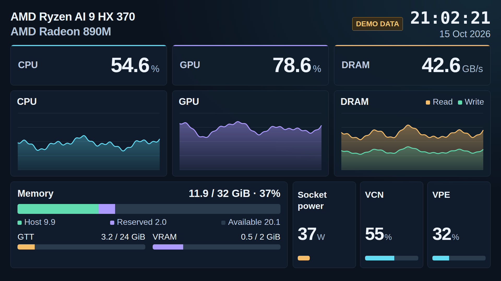

# Resource dashboard: visual prototype

Open [index.html](index.html) directly in a browser. No server, installation,
network connection or hardware access is required. All readings, hardware
names and historical samples are **synthetic**.

```bash
xdg-open examples/resource-dashboard/index.html
```

The dark 1920 × 1080 composition scales as a whole in narrower windows. Open
`index.html?video=1` for the video area alone; **DEMO DATA** remains visible.
This mode does not produce a video stream. The CPU/GPU names, date, readings
and filled graphs are sized for smaller NVR tiles. Axis labels, explanatory
notes, clock frequencies, per-process readings and separate APU/GFX power are omitted.

Use the controls outside the video area to select **Idle**, **CPU load**,
**GPU load** or **Mixed load**, pause/resume, and simulate missing GPU metrics.
Scenario changes affect new samples and retain preceding history. Pause freezes
collection and the sample clock; resume continues the simulated timeline.
Missing-metric changes take effect at the next sample or after resuming.

The preview starts with 60 seconds of generated history and updates every
100 ms. History is bounded to 601 samples and a 60-second window. Missing,
non-finite or absent readings display `N/A`; unavailable bars are striped.
Neither lines nor fills cross missing samples or large time gaps. CPU/GPU
scales remain 0–100%. DRAM read/write use a common data-driven scale in decimal
GB/s; the headline is their sum. No theoretical-bandwidth percentage is assumed.
The date and time follow sample timestamps in the browser's local timezone.



## Memory accounting

The fixture models **32 GiB**, divided into 30 GiB of Host capacity and 2 GiB
reserved for the iGPU. It distinguishes the reserved capacity from the amount
actually used within that reservation. All memory values use binary GiB.

The main bar has a capacity of `hostTotalGiB + vramReservedGiB` and shows:

- **Host:** `hostUsedGiB`, including GTT-backed pages accounted by the OS.
- **Reserved:** the complete `vramReservedGiB` reservation, even when partly idle.
- **Available:** `hostTotalGiB − hostUsedGiB`.

The headline reports **Host used + VRAM reserved**, relative to that capacity.
It measures unavailable/allocated capacity, not application-resident bytes.
The main segments never include GTT as an additional allocation. Two independent
lower bars show **GTT allocation / GTT allocation limit** and **VRAM used / VRAM reserved**.
GTT is not subtracted from Host; its accounting does not define an exact,
independent physical pool. These bars must not be added to the main bar.
The GTT fixture uses a 24 GiB allocation limit, independent of the 30 GiB Host
capacity. GTT is displayed as used / limit, with the bar normalized to that
limit. Missing, zero or invalid limits make the GTT reading unavailable; Host
capacity is never substituted. The inspected development PC reports 24 GiB
from `mem_info_gtt_total`, but live collection must detect this value.

If a required input is unavailable or inconsistent, the affected bar is striped
and its reading is `N/A`, rather than treating the value as zero. Known Host
values and independent bars remain readable. An unavailable VRAM reservation
makes the main total unavailable. Negative quantities and usage above the
corresponding capacity are invalid.

A future collector must use detected OS capacity and GPU reservation, not the
32 GiB fixture. Their sum represents the managed regions, not necessarily all
physically installed RAM. Firmware reservations and boot-time memory limits
can exclude additional memory. On the development PC checked during planning,
`mem=16G` was in the boot arguments, Linux reported about 14.27 GiB, and VRAM
reservation was 2 GiB. Those settings are unchanged; the fixture is not a
measurement or a claim that 32 GiB is currently OS-accessible.

## Metric sources for a future collector

Metric selection follows the reference repository's
[resource-utilization notes](https://github.com/bowenamd/pi05-pytorch-fast#resource-utilization-cpu--gpu--dram)
and [monitor implementation](https://github.com/bowenamd/pi05-pytorch-fast/blob/main/scripts/monitor_util.py).
These sources are documented here; this version does not collect them.

| Display | Intended source / meaning |
| --- | --- |
| CPU | `/proc/stat` deltas; whole-system utilization, 0–100% |
| GPU | amdgpu `gpu_busy_percent`; device-wide |
| Host used / capacity | `/proc/meminfo`, `MemTotal − MemAvailable` / `MemTotal` |
| VRAM reservation / used | amdgpu `mem_info_vram_total` / `mem_info_vram_used` |
| GTT allocation / limit | amdgpu `mem_info_gtt_used` / `mem_info_gtt_total`; the limit is not installed RAM |
| DRAM read / write | `gpu_metrics` v3.0 `dram_reads` / `dram_writes`, MB/s converted to GB/s; SoC-wide, CPU and GPU combined |
| Socket power | `gpu_metrics` v3.0 socket power, mW converted to W |
| VCN | `vcn_busy_percent`; codec-engine utilization where supported |
| VPE | `drm-engine-vpe` busy-time differences for observable DRM clients, divided by elapsed time and engine capacity |

See the kernel documentation for [memory reporting](https://docs.kernel.org/gpu/amdgpu/driver-misc.html)
and [DRM usage statistics](https://docs.kernel.org/gpu/drm-usage-stats.html).
GPU metrics can be SMU-filtered, approximately one second, despite 100 ms
sampling. Missing/unsupported metrics must remain unavailable. The reference
machine's 256 GB/s theoretical DRAM bandwidth is not a default for other APUs.

VCN is the name exposed by this system for the codec block (sometimes described
as VCU). VPE has no equivalent global `vpe_busy_percent` on the inspected PC.
Its future collector must deduplicate clients by device and `drm-client-id`,
use consecutive observations and account for exported engine capacity. A first
sample, inaccessible counters or unsupported hardware must produce `N/A`.
Client appearance, exit and counter resets need explicit handling. The result
covers observable clients, not necessarily the whole system; no selected NVR
PID is required. VPE in this HTML is only a synthetic design example.

## Data boundary and next stage

`window.ResourceDashboard.ingest(sample)` accepts a copied sample and renders
it; `snapshot()` returns the latest sample and history count. Pause the demo
before manual injection. Timestamps are epoch milliseconds and must increase
strictly; invalid/out-of-order timestamps are rejected. There is no live
collector integration. The sample fields are:

```javascript
{
  timestampMs,
  cpuPct, gpuPct, dramReadGBs, dramWriteGBs,
  hostUsedGiB, hostTotalGiB, vramReservedGiB, vramGiB, gttGiB, gttTotalGiB,
  socketW, vcnPct, vpePct
}
```

`vramGiB` continues to mean VRAM used; `vramReservedGiB` is its capacity.
Clock, individual APU/GFX power and process fields from the initial prototype
are removed. Machine names remain HTML fixtures to replace with discovered
metadata in a real collector. Sources must supply `null` for missing values.

After visual review, implement real collection and a separate hardware video
sample. This HTML defines the composition; it does not mandate browser capture
as the video source. The next stage must validate GPU-rendered shared surfaces,
GPU color conversion and hardware encoding without CPU pixel readback, then
serve the encoded output over RTSP. This prototype adds no encoder, RTSP server
or changes to the existing NVR application.

## Prototype validation

Checked in Chromium using local `file://` loading: all four scenarios,
pause/resume, GPU metric loss/recovery including VCN/VPE and memory, and 125
seconds of accelerated updates with bounded history. Sample-injection checks
verified that GTT and VRAM usage changes do not inflate the main total, that
reserved capacity remains distinct from usage, and that detected capacities,
invalid values and partial data are handled. Canvas pixel checks verified fill
below valid data and no fill across missing samples.

The composition fits without panel clipping at 1080p and scales without
horizontal overflow at 1920, 960, 480 and 320 pixels wide. At 480 pixels, main
readings, hardware names and graph trends remain identifiable; memory detail
labels are secondary. No browser errors or external network requests occurred.
The local validation record is `artifacts/resource-dashboard/validation-revised.json`.
